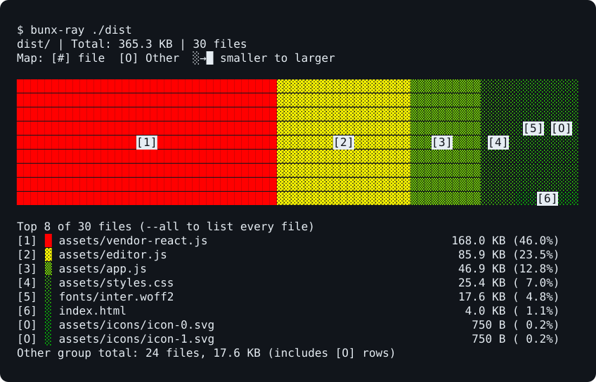

# 🎨 bunx-ray

**ASCII heat-map for any directory.** See what's taking up space, right in your terminal.



Run `bunx-ray ./dist`. Numbers connect the map to the file list, and the report fits your terminal automatically.

Rectangle area represents file size on disk. Small files and files outside the displayed list share an **Other** region; `[O]` beside a filename means it belongs to that group. Groups below the map's resolution are reported without being enlarged. Empty files stay in the list but take no map area.

---

## Install & Run

Requires Node.js `>=20`. Bun is not required.

```bash
# global (recommended)
npm install -g bunx-ray

# or one-off
npx bunx-ray ./dist
```

Point it at any directory:

```bash
bunx-ray ./dist
bunx-ray ./node_modules
bunx-ray ./
bunx-ray --all ./dist
```

---

## CLI

```
bunx-ray <dir>
```

| Flag            | Description                      |
| --------------- | -------------------------------- |
| `--all`         | Show all files in the table list |
| `-v, --version` | Show version                     |
| `-h, --help`    | Show help                        |

---

## Config File

Create a `.bunxrayrc.json` or `bunxray.config.json` in your project root to set default options.

```json
{
  "top": 15
}
```

| Field | Type     | Description                                       |
| ----- | -------- | ------------------------------------------------- |
| `top` | `number` | Maximum number of top files to show (default: 10) |

The default report shows fewer files in short terminals so the map and list fit together. `--all` always lists every file and can scroll beyond one screen. Long paths keep their filename and as much directory context as space allows.

---

## TypeScript API

```ts
import { xray, treemap, draw, renderReport } from "bunx-ray";

const mods = xray("./dist");

// Low-level
console.log(draw(treemap(mods, 80, 24), 80, 24, { color: true }));

// High-level
const report = renderReport(mods, { cols: 80, rows: 24, top: 10 });
```

For `renderReport`, `cols` and `rows` set the map dimensions; the CLI also budgets space for the summary and file list. Low-level `treemap` omits empty files and rectangles that round to zero terminal cells. `renderReport` groups small files and reports their combined size.

All `.d.ts` files ship with the package.

---

## Contributing

See [CONTRIBUTING.md](CONTRIBUTING.md) for development setup and guidelines.

## License

[MIT](LICENSE)
